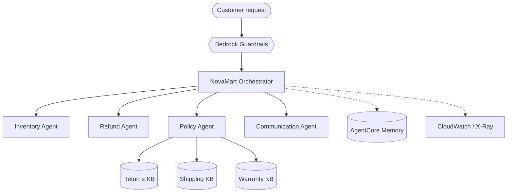
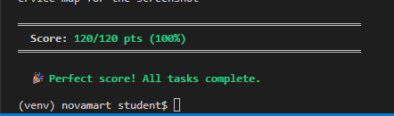
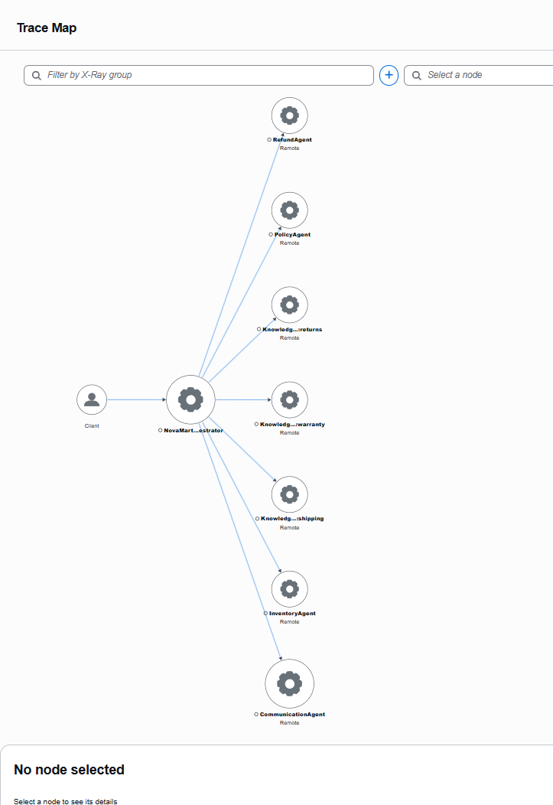

# NovaMart Multi-Agent Customer Support


> A five-agent **Orchestrator → Workers** support system for the NovaMart e-commerce help desk, built with the **Strands Agents SDK** and deployed to **Amazon Bedrock AgentCore Runtime**.

*Udacity project: Enterprise Multi-Agent Architecture with Amazon Bedrock AgentCore*

---

## Highlights

- **Orchestrator routing:** every customer request is classified and sent to the right specialist agent
- **Four worker agents:** Inventory, Refund, Policy and Communication
- **Parallel RAG:** the Policy agent queries three Bedrock Knowledge Bases (returns, shipping, warranty) at the same time
- **Production guardrails:** Bedrock Guardrails for safe responses, AgentCore Memory for conversation context
- **Full observability:** CloudWatch metrics and X-Ray tracing across every agent and Knowledge Base
- **120 / 120** on the full test suite

---

## Architecture



---

## Tech Stack

| Layer | Technology |
|---|---|
| Agent framework | Strands Agents SDK |
| Runtime | Amazon Bedrock AgentCore Runtime |
| Retrieval | Amazon Bedrock Knowledge Bases (×3) |
| Safety | Amazon Bedrock Guardrails |
| State | AgentCore Memory |
| Observability | Amazon CloudWatch · AWS X-Ray |

---

## Key Files

| File | Description |
|---|---|
| `src/agent_orchestrator.py` | Completed implementation (Tasks 2, 3, 4 and 6) |
| `.env.example` | Populated Knowledge Base IDs, AgentCore Runtime ARN, guardrail ID/version |
| `scripts/sync_env.py` | Helper that fills `.env` from the AWS account |

> All other files are the unchanged Udacity starter.

---

## Results

| Screenshot | What it shows |
|---|---|
| [`01-test-suite-score-120-of-120.png`](screenshots/01-test-suite-score-120-of-120.png) | Full test suite (`python tests/test_agent.py all`) passing **120/120** |
| [`02-xray-service-map-all-agents.png`](screenshots/02-xray-service-map-all-agents.png) | X-Ray trace map: Orchestrator connected to all worker agents and the three Knowledge Bases |
| [`03-xray-service-map-list-view.png`](screenshots/03-xray-service-map-list-view.png) | List view of the same nodes, with full names, latency and **zero faults** |

### Test suite


### X-Ray service map


---

## Running the tests

```bash
python tests/test_agent.py all
```
